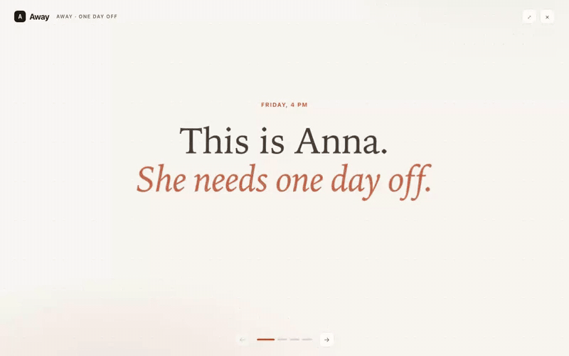
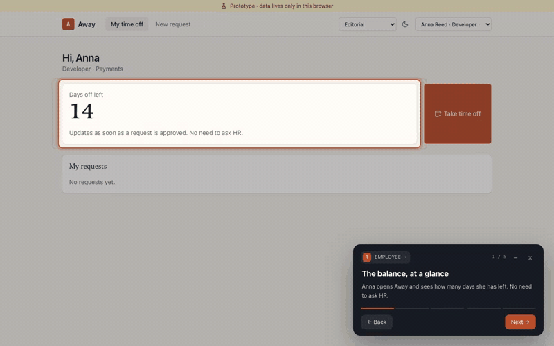
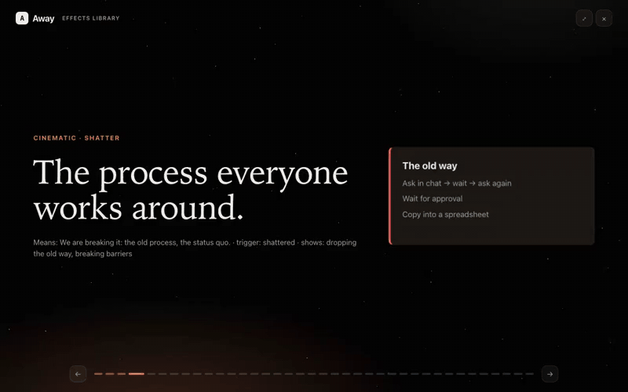

# neoslides

**A Claude Code skill that turns a product idea into a talk people remember:** a clickable prototype of the product, plus an animated in-browser presentation that hands over to a live guided tour of that prototype and back.

No slide deck. The story scenes explain the problem with motion that *means* something (the old form burns, the bottleneck opens, the wall between two teams falls), then the presenter clicks through the real-feeling product, then the talk closes with what's next and a live poll.



## What you get

From one sentence like *"make a pitch for a leave-request tool for our HR team"*, the skill:

1. **Reads the request and proposes the whole direction in one message:** audience and goal, story pattern and scene list, the 2–4 key animations ("scene → effect → what it means"), the live-demo moments, the visual style, and at most three open questions, each with a default.
2. **Copies a style if you give one:** a link, a screenshot or your brand. It extracts colours, type and spacing in the browser, writes `STYLE.md`, and shows you one styled scene next to your reference before writing the rest.
3. **Builds one Next.js app** with:
   - **the prototype:** a few focused screens on mock state in `localStorage`, with personas and a visible "prototype" banner;
   - **the talk:** scenes × beats driven by a clicker or keyboard, staggered reveals, fullscreen;
   - **the live tour:** a spotlight on real elements, a presenter panel with what to say and what to click, a chapter menu, and persona switching. Every step can be opened directly.
4. **Verifies it in a real browser** (`npm run verify`): every scene and beat, every tour step with a reload, reduced motion and phone width. It writes screenshots taken mid-animation.



## 37 meaning-bearing effects

Every effect has a one-sentence meaning in a registry ([`effects.ts`](assets/template/components/deck/effects.ts)). The skill picks an effect from what the information *is* (a number, a comparison, a process, a turning point…), not from what looks cool.

- **Cinematic:** big bang, burn, shatter, dust, wall collapse, bottleneck, parcel path, vortex, paper plane, domino chain, city lights, fireworks, collapse.
- **Data:** count-up, progress ring, compare bars, race, dot matrix, growth line, timeline, calendar, zoom out.
- **Diagrams:** chaos → order, network → hub, layer stack, pipeline, input → output, chat replay, leaky bucket, stamp, fog, checklist, shield, balance scale, wipe, poll, ghost cursor.



Each effect is driven by a prop, so the presenter controls time. Each one also has a reduced-motion end state and a phone layout. Browse them all at `/effects` (dark stage) and `/effects?stage=paper` (light stage) in any generated project.

## Install

**Ask Claude to do it.** Paste this into Claude Code: *"Install the neoslides skill from github.com/maksspace/neoslides"*. Claude follows the steps below.

### For AI agents

If you are an AI agent asked to install neoslides:

1. Check `node --version` is 20 or newer; if not, tell the person to install Node.js 20+ first.
2. Run `git clone https://github.com/maksspace/neoslides ~/.claude/skills/neoslides`. If that folder already exists, run `git -C ~/.claude/skills/neoslides pull` instead.
3. Tell the person it's installed and that a new Claude Code session may be needed for the skill to show up. Then ask what they want to present, or start right away if they already said.

Don't use the `/plugin` commands below yourself: they are typed by the person.

### By hand

**As a plugin** (Claude Code):

```
/plugin marketplace add maksspace/neoslides
/plugin install neoslides@neoslides
```

**Or as a plain skill:**

```bash
git clone https://github.com/maksspace/neoslides ~/.claude/skills/neoslides
```

You'll need Node.js 20+ to build the generated project. `npm run verify` needs a Chromium. It uses `CHROME_PATH`, a Playwright browser (`npx playwright install chromium`) or an installed Chrome.

## Use

Just ask Claude Code, in any language:

> Make a presentation for our new on-call scheduling tool. Audience: engineering managers. Style like linear.app.

> I want to pitch an internal expense-approval bot to the CFO. 10 minutes, with a live demo.

> neoslides: a launch talk for our analytics dashboard, in the style of this screenshot.

Then run the project it creates:

```bash
npm run dev       # http://localhost:3000
npm run build     # static talk in ./out
npm run verify    # headless walk of the whole talk; screenshots in ./verify
npm run share   # a shareable link like https://k7f3x9q2ab.neoslides.app/
```

**Sharing.** `npm run share` signs you in once with Google (it prints a link to open), uploads the static talk and prints an unlisted link. Re-running it updates the same link; `-- --list`, `-- --delete` and `-- --new` manage decks, and the agent runs all of these for you when asked. See [docs/sharing.md](docs/sharing.md).

**Presenter keys.** In the deck: `→` / `Space` / `PageDown` next, `←` / `PageUp` back, `F` fullscreen, `Esc` to the product. In the tour: `→` / `←` and `H` to collapse the panel. Clickers work out of the box.

## Principles

- **Mock is never presented as real.** The prototype banner stays on every product screen, and there are no real integrations or credentials.
- **One idea per scene, and at most one animation**, which you must be able to explain in one sentence.
- **The product is the show:** no effects inside the live tour.
- **Copy a style, not an identity:** no logos, brand names, lifted illustrations or unlicensed fonts from a reference that isn't yours.

## What's inside

```
SKILL.md                 the workflow Claude follows
references/              storytelling, animation patterns, motion method, visuals, style-from-reference, quality bar
scripts/extract-style.js runs in the browser to pull a site's colours, type and spacing
assets/template/         the Next.js 16 app every project starts from (engine + an example talk to replace)
```

The example talk in the template ("Away", a leave-request tool) only shows the shape of the files. Every real talk gets its own story, style and effects.

## Contributing

New effects, stages and story patterns are welcome. See [CONTRIBUTING.md](CONTRIBUTING.md). Changes are listed in [CHANGELOG.md](CHANGELOG.md).

## License

[MIT](LICENSE)
